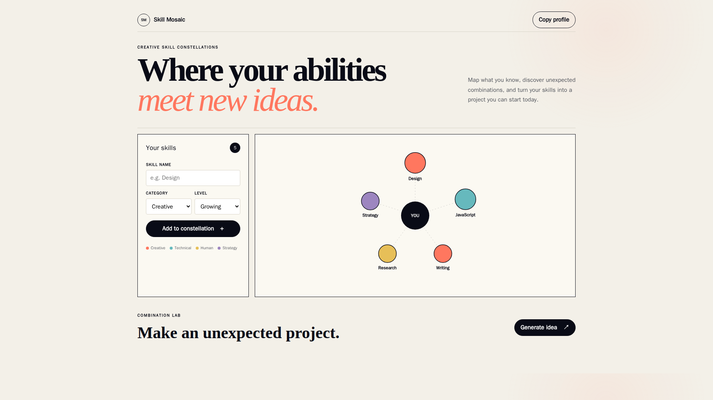
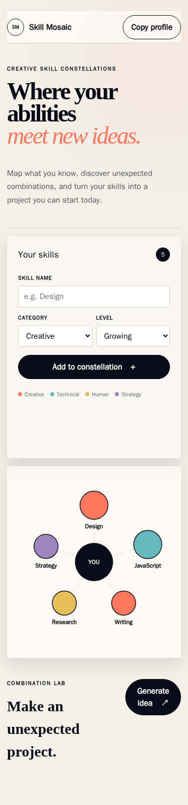

# Open Source Showcase

## Projects

- [Skill Mosaic](.) — A creative skill-constellation builder that connects abilities into project ideas.
- [Idea Loom](idea-loom/) — An idea-to-mind-map studio with editable nodes and Figma-compatible exports.
- [Brand Kit Forge](brand-kit-forge/) — A deterministic brand identity generator with WCAG contrast, production tokens, mockups, and guidelines.

## Shared design system

Every project uses [`shared/design-system/`](shared/design-system/) for light/dark tokens, rem typography, translucent materials, and dependency-free spring motion.

- Typography uses system-ui with optical sizing, size-specific tracking, and leading that tightens on display text.
- Motion starts at the live on-screen value, preserves release velocity, projects momentum, and rubbers at boundaries.
- Translucent toolbars and panels use backdrop blur and scroll-edge fade masks; reduced-motion, reduced-transparency, and increased-contrast preferences are supported.

Interaction and motion principles adapted from the apple-design skill by Emil Kowalski (github.com/emilkowalski/skills).

## Skill Mosaic design update

Skill Mosaic now uses the shared Apple-style system for rem typography, light/dark materials, instant pointer-down feedback, 1:1 constellation-node manipulation, spring handoff, momentum projection, and interruptible motion.

### Before

### After

