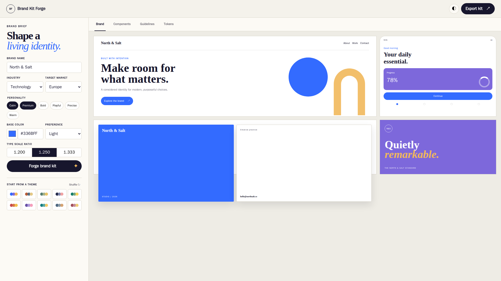
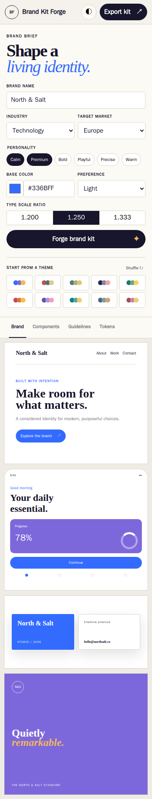

# Brand Kit Forge

Brand Kit Forge turns a short brand brief into a production-ready identity system. It deterministically generates palettes, WCAG-safe contrast, typography, spacing, voice rules, mockups, and editable exports.

## Features

- Deterministic brief-based generation
- Primary, secondary, accent, neutral, and semantic color scales
- WCAG 2.2 contrast checking with failing-pair auto-fix
- Curated Google Font pairings mapped to personality
- Selectable 1.2, 1.25, and 1.333 type scales
- 4/8pt spacing, radius, and shadow tokens
- Three-rule brand voice with Do/Don't examples
- Ten starter themes and locked-color shuffle
- Light/dark live previews
- Landing page, app, business card, social post, and component mockups
- CSS, Tailwind, DTCG, Figma Variables, guidelines HTML, and share URL exports

## Run locally

```bash
cd brand-kit-forge
python3 -m http.server 4175
```

Open http://localhost:4175.

## Test

```bash
cd brand-kit-forge
npm test
```

## Browser screenshots





## Export formats

- **CSS:** download custom properties for `--color-*`, `--font-*`, `--space-*`, `--radius-*`, and `--shadow-*`.
- **Tailwind:** download a config whose complete palette and tokens are inside `theme.extend`.
- **DTCG:** download W3C design-token format JSON with `$value`, `$type`, and a `$schema`.
- **Figma Variables:** download a structure ready to adapt to Figma Variables or Tokens Studio.
- **Guidelines:** download print-ready HTML and use the browser's **Save as PDF** command.
- **Share:** copies a URL containing the encoded brief.

## Figma MCP import

1. Generate the kit and choose **Export kit > Figma / Tokens Studio**.
2. Import `*-figma-variables.json` into Tokens Studio or transform `variables` into Figma variable collections.
3. In Figma, create **Brand** as a collection with **Light** and **Dark** modes.
4. Add each exported variable to the collection as a color or float variable.
5. For Figma MCP, pass the exported JSON as the variable-creation payload. The project uses a stable name and includes collection, mode, type, and value fields.
6. Apply the resulting variables to the landing page, app, card, social, and component mockups.

No Figma MCP server or API credentials are required by this plain-JavaScript project.

## Before and after


## Claude Agent Skill

The valid Claude Agent Skill package is at [`skill/SKILL.md`](skill/SKILL.md). It includes generation instructions, algorithm references, and two complete brand examples.
