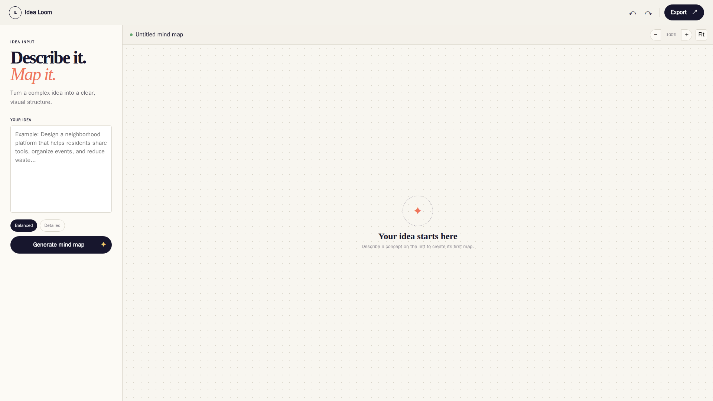
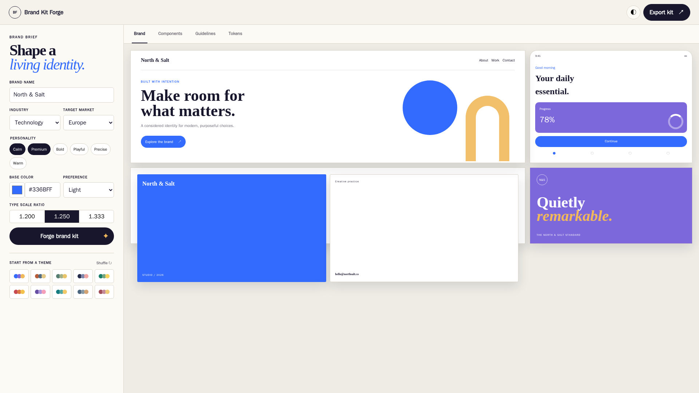

# Idea Loom

Idea Loom is a complete browser-based mind-map studio for turning complex ideas into structured, editable visual maps.

## Features

- Generate balanced or detailed mind maps from natural-language ideas
- Drag nodes directly on an infinite-style canvas
- Undo and redo map changes
- Zoom and fit controls
- Export to JSON, SVG, Mermaid, or a Figma MCP-compatible frame payload
- Copy exports directly to the clipboard
- Zero runtime dependencies

## Run locally

```bash
cd idea-loom
python3 -m http.server 4174
```

Open http://localhost:4174.

## Test

```bash
cd idea-loom
npm test
```

## Figma MCP

The app does not invoke Figma directly because no Figma MCP connection is configured in this environment. Choose **Export > Figma MCP**, then paste the copied JSON payload into a Figma MCP-compatible create-frame tool.

The payload includes the frame name, dimensions, background color, node labels, positions, dimensions, and fill colors. It is intentionally tool-neutral so it can be mapped to a Figma MCP implementation.

## Before and after





The updated interface uses shared rem tokens and translucent materials. Mind-map nodes and the canvas use Pointer Events, capture, grab offsets, a 10px drag threshold, momentum projection, and interruptible springs.
